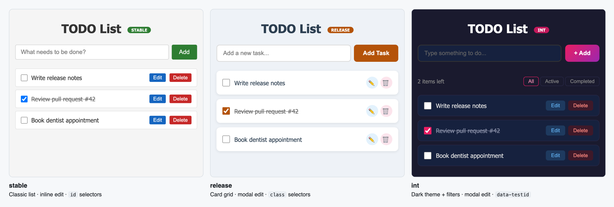
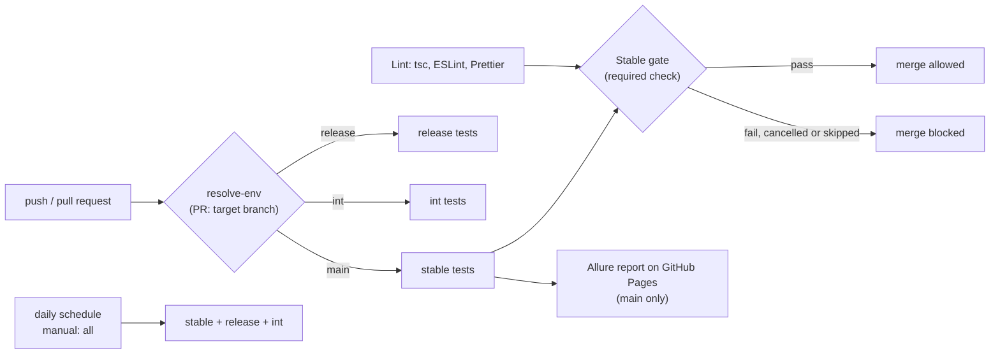

# playwright-multi-env-framework

[](https://github.com/BRLorena/playwright-multi-env-framework/actions/workflows/test.yml)
[](https://brlorena.github.io/playwright-multi-env-framework/)

> A Playwright + TypeScript framework that runs one test suite against three environments with different UIs, selectors and edit flows. It covers UI, API, auth and accessibility tests, runs them in parallel with branch-scoped CI, and blocks merges when stable fails.

**📊 [Live Allure report](https://brlorena.github.io/playwright-multi-env-framework/)**: all three environments, refreshed daily from `main`, with history and trends.

---

## Results

| | Result |
| --- | --- |
| **Tests** | 87 across 3 environments (28 stable, 29 release, 30 int): UI, API, auth and accessibility |
| **Speed** | Full suite in about 19s locally (fully parallel); each environment in about 6s in CI |
| **Stability** | 435 of 435 passed in a stress run (5 repeats, 8 workers), with no flaky tests and no sleeps |
| **Failing fast** | A broken selector fails CI in under 2 min instead of 16 ([PR #2](https://github.com/BRLorena/playwright-multi-env-framework/pull/2)) |
| **Merge gate** | PRs to `main` need stable tests and lint to pass, enforced by branch protection |
| **Accessibility** | Every screen of all three UIs passes axe-core WCAG 2.1 AA |



---

## Why this project exists

Most QA portfolios show tests against a single URL. Real products have multiple environments — each with different selectors, interaction patterns, feature flags, and credentials. This project was built to demonstrate exactly that:

- How to architect a test framework that handles **env-specific UI differences** without duplicating tests
- How to manage **per-environment authentication** with Playwright's `storageState`
- How to run the whole suite **fully in parallel** without tests sharing data
- How to wire **branch-aware CI pipelines** that run only the relevant environment's tests
- How to **block merges** when the stable environment's tests fail
- How to make **accessibility** part of the regression suite, not a one-off audit

---

## Architecture

```
config/
  environments.ts           Envs, ports, base URLs, credentials (single source of truth)

app/                        Express server (serves 3 env variants)
  routes/
    auth.ts                 Login API + requireAuth middleware
    todos.ts                CRUD API, one todo list per session
  public/
    index-{stable,release,int}.html   Different UI per env
    login-{stable,release,int}.html   Login pages per env

tests/
  specs/
    crud.spec.ts            Core CRUD tests — run on ALL envs (@all)
    ui-variant.spec.ts      Env-specific UI tests (@stable/@release/@int)
    auth.spec.ts            Login flow: redirect, valid login, wrong password (@all)
    api.spec.ts             API contract: validation, 401/404, session isolation (@all)
    a11y.spec.ts            axe-core WCAG 2.1 AA scans of every screen (@all)
  pages/
    todo.page.ts            Page Object Model, env-aware, exposes locators
    login.page.ts           Login page object
  helpers/
    selectors.ts            Per-env selector map (the key abstraction)
    a11y.ts                 axe-core scan returning readable violations
  fixtures/
    todo.fixture.ts         Per-worker login, typed envName option, TodoPage + clean state
```

**87 tests** across the three environments (28 stable, 29 release, 30 int): UI, API, auth and accessibility.

### Environment matrix

| Environment | Port | UI style             | Edit pattern | Selectors     |
| ----------- | ---- | -------------------- | ------------ | ------------- |
| **stable**  | 3001 | Classic list         | Inline edit  | `id`-based    |
| **release** | 3002 | Card grid            | Modal        | `class`-based |
| **int**     | 3003 | Dark theme + filters | Modal        | `data-testid` |

---

## Key design decisions

### 1. Single selector map, all envs covered

[tests/helpers/selectors.ts](tests/helpers/selectors.ts) holds a per-env selector map. The same test code interacts with `stable`, `release`, and `int` without branching logic in specs — only the selectors change. The env-specific specs read their selectors from the same map, so a UI change is fixed in one place.

### 2. Auth with `storageState`, one session per worker

Each Playwright worker logs in once through the real login page and every test in that worker reuses its `storageState` (Playwright's [one account per parallel worker](https://playwright.dev/docs/auth#moderate-one-account-per-parallel-worker) pattern). The app keeps one todo list per session, so workers never see each other's data and the suite runs **fully parallel**: all 87 tests in about 19s locally, each env in about 6s in CI.

### 3. No sleeps, only web-first assertions

Page objects expose locators, and actions wait for the app to re-fetch the list after a change, instead of `waitForTimeout` or `waitForSelector`. Specs assert with auto-retrying expects (`toHaveText`, `toBeChecked`, `toHaveCount`). [`eslint-plugin-playwright`](https://github.com/playwright-community/eslint-plugin-playwright) enforces this in CI. The suite passed 435 of 435 runs (5 repeats, 8 workers) with no flaky tests.

### 4. Environments are data, not code

[config/environments.ts](config/environments.ts) defines the environments once; the Playwright projects and local web servers are generated from it. Setting `{ENV}_BASE_URL` points the same suite at a deployed environment instead of localhost.

### 5. Branch → environment mapping in CI



Pull requests run the tests of the branch they merge **into**, so a PR to `main` always runs stable. Pushing to `release` won't run stable tests. The daily schedule and a manual `all` run cover all three environments.

### 6. Merge gate on stable

A dedicated `Stable gate` job runs on every PR to `main` and is a **required status check** in branch protection. It requires both the stable tests and the `Lint` job (type-check, ESLint, Prettier) to pass. Any result other than success (failed, cancelled or skipped) blocks the merge, and the gate also fails if the PR didn't run the stable suite.

**See it in action:** [Demo PR #2](https://github.com/BRLorena/playwright-multi-env-framework/pull/2) renames the stable env's Add button id without updating the tests. 15 stable tests fail, the `Stable gate` fails, and the merge is blocked.


<details>
<summary>The pipeline run behind it</summary>


</details>

### 7. Accessibility as a regression test

[tests/specs/a11y.spec.ts](tests/specs/a11y.spec.ts) runs [axe-core](https://github.com/dequelabs/axe-core) against WCAG 2.1 A/AA on every screen of every environment: the list with active and completed items, edit mode (inline or modal) and the login page with an error. A failure lists each rule and element, e.g. `color-contrast: #add-todo`.

The first scan found violations in all three UIs: unlabelled checkboxes and low-contrast buttons, badges and completed items. They were fixed in the app, and the scan now runs on every PR, so a new one blocks the merge like any other failing test.

---

## Running locally

```bash
# Install dependencies (Node 22+)
npm install
npx playwright install chromium

# Copy env file and fill credentials
cp .env.example .env   # or edit .env directly

# Run all environments (servers auto-start via webServer config)
npx playwright test

# Run a single environment
npx playwright test --project=stable
npx playwright test --project=release
npx playwright test --project=int

# Type-check, lint and format check (what the CI Lint job runs)
npm run check

# Build the Allure 3 report from the last run and open it
npm run report

# Start a server manually (useful for exploratory testing)
npm run dev:stable    # http://localhost:3001
npm run dev:release   # http://localhost:3002
npm run dev:int       # http://localhost:3003
```

---

## Environment variables

Credentials are loaded from `.env` (never committed). The same variables are stored as GitHub Actions secrets for CI.

| Variable           | Description                    |
| ------------------ | ------------------------------ |
| `STABLE_USERNAME`  | Login username for stable env  |
| `STABLE_PASSWORD`  | Login password for stable env  |
| `RELEASE_USERNAME` | Login username for release env |
| `RELEASE_PASSWORD` | Login password for release env |
| `INT_USERNAME`     | Login username for int env     |
| `INT_PASSWORD`     | Login password for int env     |

Optional:

| Variable          | Description                                                                           |
| ----------------- | ------------------------------------------------------------------------------------- |
| `{ENV}_BASE_URL`  | Run an env against a deployed URL instead of localhost, e.g. `STABLE_BASE_URL=https://…` |
| `TEST_ENVS`       | Limit the run (projects and servers) to some envs, e.g. `stable` or `stable,int`      |

---

## CI/CD

GitHub Actions workflow: [`.github/workflows/test.yml`](.github/workflows/test.yml)

Triggers:

- `push` → runs tests for the pushed branch's environment
- `pull_request` → runs tests for the target branch's environment (PRs to `main` run stable and must pass the `Stable gate`)
- `schedule` (daily 6am UTC) → runs all three environments
- `workflow_dispatch` → manually pick `stable`, `release`, `int`, or `all`

The Allure report is published to [GitHub Pages](https://brlorena.github.io/playwright-multi-env-framework/) only from `main`, so PRs and the `release`/`int` branches never overwrite it. The report is built with Allure 3 ([allurerc.mjs](allurerc.mjs)); each run downloads the previous `history.jsonl` from Pages and publishes the updated one, so trends carry over.

Every run's summary page shows a pass / fail / flaky / skipped table per environment, read from Playwright's JSON report, and lists any test that only passed on retry.

### Pipeline speed

- Playwright browsers are cached between runs, and the install is skipped on a cache hit
- Only the server for the environment under test is started
- Tests run fully parallel on 4 workers
- 1 retry in CI, with 5s action and assertion timeouts (Playwright's default is 30s): the app responds in milliseconds, so a broken selector fails in seconds

A green environment runs its tests in about 6s. A broken build fails in under 2 minutes (1m 43s) instead of 16 (measured on [PR #2](https://github.com/BRLorena/playwright-multi-env-framework/pull/2)).

The `Playwright webServer` config starts and stops the app automatically in CI — no separate server startup step needed.

---

## Tech stack

- **App:** Node.js, Express 5, TypeScript
- **Tests:** Playwright 1.64, TypeScript, Allure 3, axe-core
- **Quality:** ESLint (typescript-eslint, eslint-plugin-playwright), Prettier, `tsc` type-check
- **Auth:** Bearer session token in `localStorage`, per-env credentials via env vars
- **CI:** GitHub Actions with matrix strategy and branch-scoped execution
