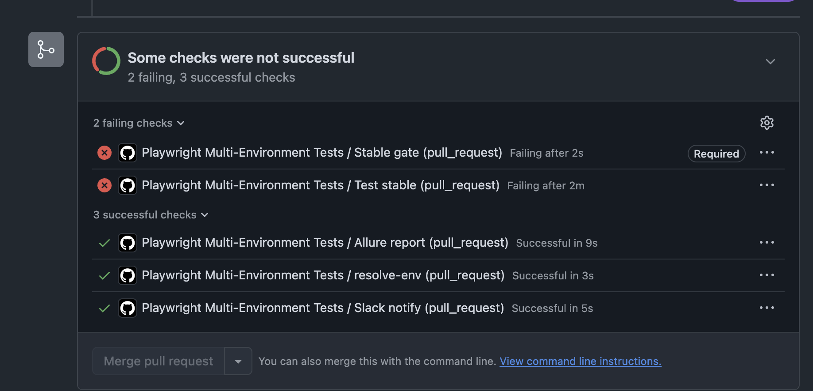
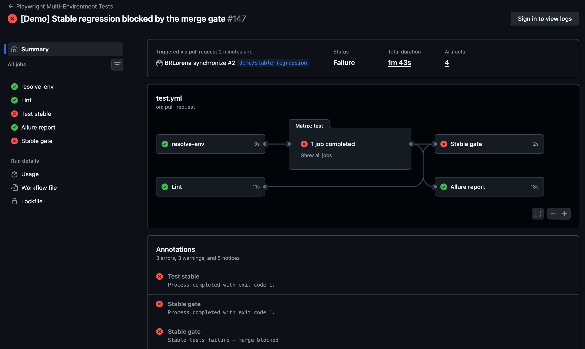

# playwright-multi-env-framework

[](https://github.com/BRLorena/playwright-multi-env-framework/actions/workflows/test.yml)
[](https://brlorena.github.io/playwright-multi-env-framework/)

> A production-grade Playwright test framework for a multi-environment web app — demonstrating how QA automation scales across stable, release, and integration environments with auth, CI/CD, and branch-scoped test execution.

**📊 [Live Allure report](https://brlorena.github.io/playwright-multi-env-framework/)**: all three environments, refreshed daily from `main`, with history and trends.

---

## Why this project exists

Most QA portfolios show tests against a single URL. Real products have multiple environments — each with different selectors, interaction patterns, feature flags, and credentials. This project was built to demonstrate exactly that:

- How to architect a test framework that handles **env-specific UI differences** without duplicating tests
- How to manage **per-environment authentication** with Playwright's `storageState`
- How to run the whole suite **fully in parallel** without tests sharing data
- How to wire **branch-aware CI pipelines** that run only the relevant environment's tests
- How to **block merges** when the stable environment's tests fail

---

## Architecture

```
config/
  environments.ts           Envs, ports, base URLs, credentials (single source of truth)

app/                        Express server (serves 3 env variants)
  routes/
    auth.ts                 Login API + requireAuth middleware
    todos.ts                CRUD API, one todo list per session
  public/
    index-{stable,release,int}.html   Different UI per env
    login-{stable,release,int}.html   Login pages per env

tests/
  specs/
    crud.spec.ts            Core CRUD tests — run on ALL envs (@all)
    ui-variant.spec.ts      Env-specific UI tests (@stable/@release/@int)
    auth.spec.ts            Login flow: redirect, valid login, wrong password (@all)
    api.spec.ts             API contract: validation, 401/404, session isolation (@all)
  pages/
    todo.page.ts            Page Object Model, env-aware, exposes locators
    login.page.ts           Login page object
  helpers/
    selectors.ts            Per-env selector map (the key abstraction)
  fixtures/
    todo.fixture.ts         Per-worker login, typed envName option, TodoPage + clean state
```

**69 tests** across the three environments (22 stable, 23 release, 24 int): UI, API and auth.

### Environment matrix

| Environment | Port | UI style             | Edit pattern | Selectors     |
| ----------- | ---- | -------------------- | ------------ | ------------- |
| **stable**  | 3001 | Classic list         | Inline edit  | `id`-based    |
| **release** | 3002 | Card grid            | Modal        | `class`-based |
| **int**     | 3003 | Dark theme + filters | Modal        | `data-testid` |

---

## Key design decisions

### 1. Single selector map, all envs covered

[tests/helpers/selectors.ts](tests/helpers/selectors.ts) holds a per-env selector map. The same test code interacts with `stable`, `release`, and `int` without branching logic in specs — only the selectors change. The env-specific specs read their selectors from the same map, so a UI change is fixed in one place.

### 2. Auth with `storageState`, one session per worker

Each Playwright worker logs in once through the real login page and every test in that worker reuses its `storageState` (Playwright's [one account per parallel worker](https://playwright.dev/docs/auth#moderate-one-account-per-parallel-worker) pattern). The app keeps one todo list per session, so workers never see each other's data and the suite runs **fully parallel**: all 69 tests in about 19s locally, each env in about 6s in CI.

### 3. No sleeps, only web-first assertions

Page objects expose locators, and actions wait for the app to re-fetch the list after a change, instead of `waitForTimeout` or `waitForSelector`. Specs assert with auto-retrying expects (`toHaveText`, `toBeChecked`, `toHaveCount`). [`eslint-plugin-playwright`](https://github.com/playwright-community/eslint-plugin-playwright) enforces this in CI. The suite passed 345 of 345 runs (5 repeats, 8 workers) with no flaky tests.

### 4. Environments are data, not code

[config/environments.ts](config/environments.ts) defines the environments once; the Playwright projects and local web servers are generated from it. Setting `{ENV}_BASE_URL` points the same suite at a deployed environment instead of localhost.

### 5. Branch → environment mapping in CI

```
main     →  stable tests only
release  →  release tests only
int      →  int tests only
```

Pull requests run the tests of the branch they merge **into**, so a PR to `main` always runs stable. Pushing to `release` won't run stable tests. The daily schedule and a manual `all` run cover all three environments.

### 6. Merge gate on stable

A dedicated `Stable gate` job runs on every PR to `main` and is a **required status check** in branch protection. It requires both the stable tests and the `Lint` job (type-check, ESLint, Prettier) to pass. Any result other than success (failed, cancelled or skipped) blocks the merge, and the gate also fails if the PR didn't run the stable suite.

**See it in action:** [Demo PR #2](https://github.com/BRLorena/playwright-multi-env-framework/pull/2) renames the stable env's Add button id without updating the tests. 11 stable tests fail, the `Stable gate` fails, and the merge is blocked.



<details>
<summary>The pipeline run behind it</summary>



</details>

---

## Running locally

```bash
# Install dependencies (Node 22+)
npm install
npx playwright install chromium

# Copy env file and fill credentials
cp .env.example .env   # or edit .env directly

# Run all environments (servers auto-start via webServer config)
npx playwright test

# Run a single environment
npx playwright test --project=stable
npx playwright test --project=release
npx playwright test --project=int

# Type-check, lint and format check (what the CI Lint job runs)
npm run check

# Start a server manually (useful for exploratory testing)
npm run dev:stable    # http://localhost:3001
npm run dev:release   # http://localhost:3002
npm run dev:int       # http://localhost:3003
```

---

## Environment variables

Credentials are loaded from `.env` (never committed). The same variables are stored as GitHub Actions secrets for CI.

| Variable           | Description                    |
| ------------------ | ------------------------------ |
| `STABLE_USERNAME`  | Login username for stable env  |
| `STABLE_PASSWORD`  | Login password for stable env  |
| `RELEASE_USERNAME` | Login username for release env |
| `RELEASE_PASSWORD` | Login password for release env |
| `INT_USERNAME`     | Login username for int env     |
| `INT_PASSWORD`     | Login password for int env     |

Optional:

| Variable          | Description                                                                           |
| ----------------- | ------------------------------------------------------------------------------------- |
| `{ENV}_BASE_URL`  | Run an env against a deployed URL instead of localhost, e.g. `STABLE_BASE_URL=https://…` |
| `TEST_ENVS`       | Limit the run (projects and servers) to some envs, e.g. `stable` or `stable,int`      |

---

## CI/CD

GitHub Actions workflow: [`.github/workflows/test.yml`](.github/workflows/test.yml)

Triggers:

- `push` → runs tests for the pushed branch's environment
- `pull_request` → runs tests for the target branch's environment (PRs to `main` run stable and must pass the `Stable gate`)
- `schedule` (daily 6am UTC) → runs all three environments
- `workflow_dispatch` → manually pick `stable`, `release`, `int`, or `all`

The Allure report is published to [GitHub Pages](https://brlorena.github.io/playwright-multi-env-framework/) only from `main`, so PRs and the `release`/`int` branches never overwrite it. Each run downloads the previous report's history so trends carry over.

Every run's summary page shows a pass / fail / flaky / skipped table per environment, read from Playwright's JSON report, and lists any test that only passed on retry.

### Pipeline speed

- Playwright browsers are cached between runs, and the install is skipped on a cache hit
- Only the server for the environment under test is started
- Tests run fully parallel on 4 workers
- 1 retry in CI, with 5s action and assertion timeouts (Playwright's default is 30s): the app responds in milliseconds, so a broken selector fails in seconds

A green environment runs its tests in about 6s. A broken build fails in about 2.5 minutes instead of 16 (measured on [PR #2](https://github.com/BRLorena/playwright-multi-env-framework/pull/2)).

The `Playwright webServer` config starts and stops the app automatically in CI — no separate server startup step needed.

---

## Tech stack

- **App:** Node.js, Express, TypeScript
- **Tests:** Playwright 1.64, TypeScript, Allure
- **Quality:** ESLint (typescript-eslint, eslint-plugin-playwright), Prettier, `tsc` type-check
- **Auth:** JWT-style token in `localStorage`, per-env credentials via env vars
- **CI:** GitHub Actions with matrix strategy and branch-scoped execution
